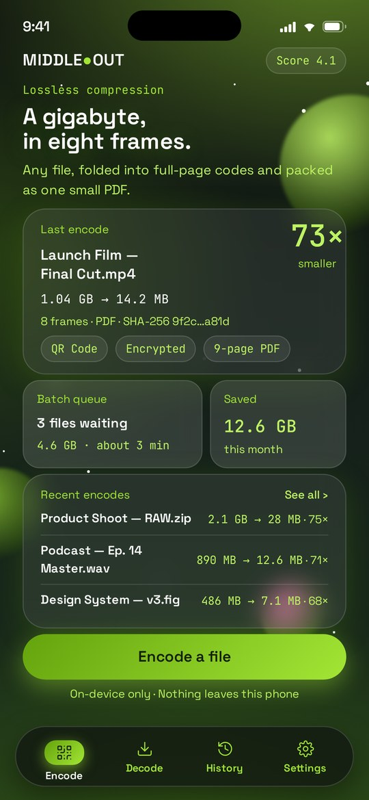
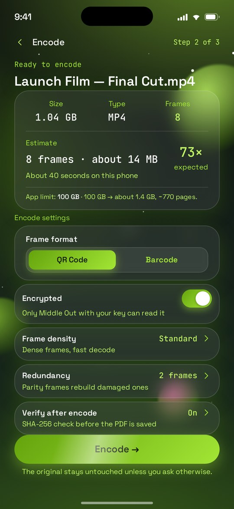
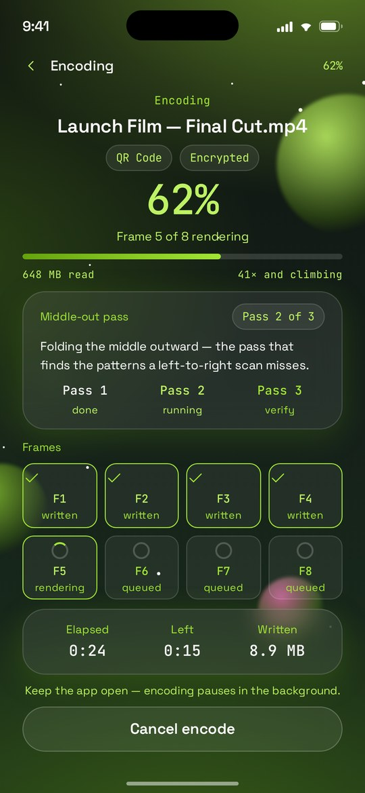
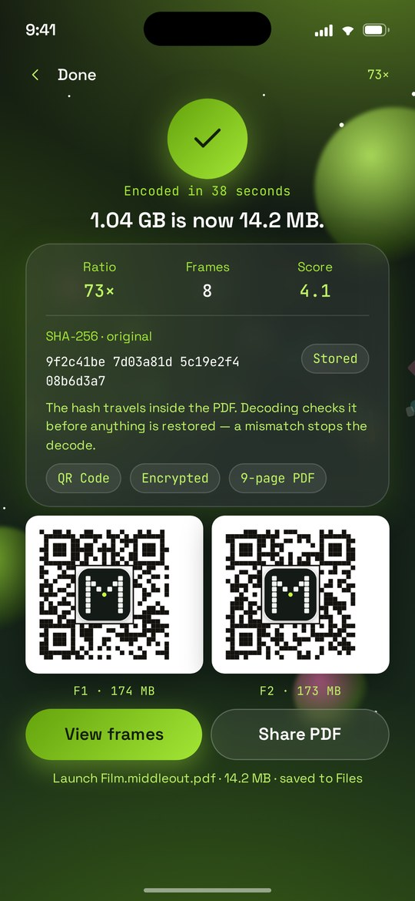
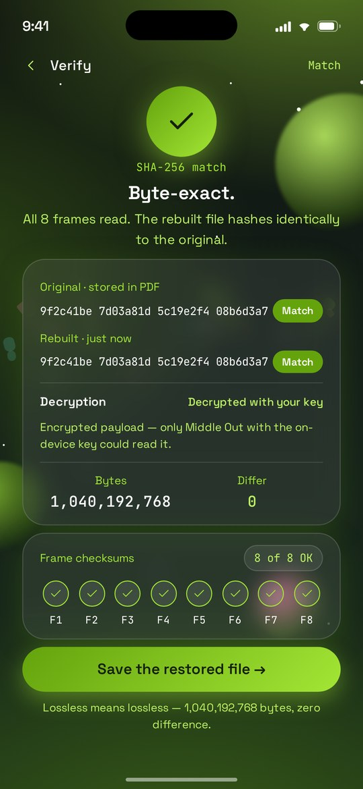

  

# Middle Out

**Send small, open big.** Pied Piper-style lossless compression — any file folds into a handful of full-page codes and packs into one small PDF. Decode it and the original comes back bit-for-bit.

Files keep getting bigger and the ways we move them keep getting in the way. Middle Out folds the whole file — every byte of it — into full-page visual codes, one big code per page, packed as a single PDF small enough to send anywhere a PDF goes. The demo's example encode: a 1.04 GB film master becomes a 14.2 MB PDF, 73× smaller. Open it in Middle Out and the full file comes back, verified byte-for-byte before anything is shown as decoded.

- **Encode** — pick a file and see the estimate up front: frames, PDF size, ratio. Choose QR or barcode, encryption on by default.
- **Frames & PDF** — one cover page plus one page per frame, with extra parity frames that restore a damaged one.
- **Decode** — import the PDF and get the original back, on your device, no upload.
- **Verify** — every decode is checked against the fingerprint stored in the PDF: 0 bytes differ, or it fails loudly.
- **Share & history** — send the PDF itself, or a link that expires in 7 days; the batch queue and history keep every encode.
- **Guest-first** — no account needed. Everything works on-device; signing in adds sync and cloud encode.

  
  
  
  
  

[**Try the live demo →**](https://mr-vishwet.github.io/middle-out/)
