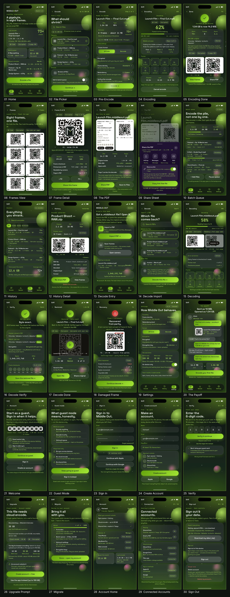
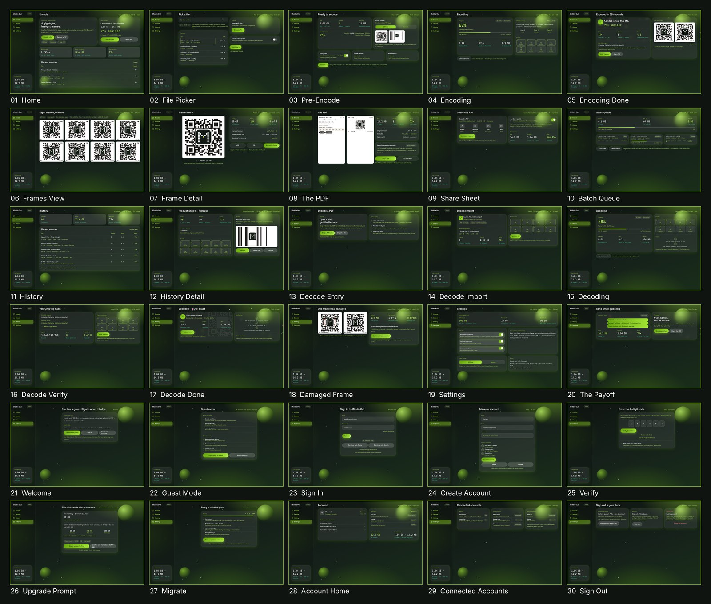

  

# Middle Out

**Lossless compression into visual frames.** Any file, folded into full-page codes and packed as one small PDF — a 1 GB file encodes into a 5–20 MB PDF, and decoding the PDF brings the original back bit-for-bit.

[**Try the live demo →**](https://mr-vishwet.github.io/middle-out/)

## The idea

Files keep getting bigger and the ways we move them keep getting in the way. A finished film, a raw photo shoot, a podcast master — gigabytes that don't fit in an email, stall on slow connections, and cost real money to store and send. The usual answers are all compromises: lossy compression throws quality away, cloud links expire or need an account on the other end, and splitting a file into pieces is a chore nobody wants.

Middle Out takes a different route. Instead of shrinking a file by throwing data away, it folds the whole file — every byte of it — into a set of full-page visual codes and packs those pages into a single PDF. One big code per page: a QR-style grid by default, or a stacked barcode if you prefer. Each code carries the Middle Out icon in its centre. The result is an ordinary PDF, small enough to send anywhere a PDF goes — a message, an email attachment, a drive folder, even a printout — and it holds the entire original file inside it.

The promise is deliberately simple: **send small, open big.** A 1.04 GB film master becomes a 14.2 MB PDF. You send the PDF; the person on the other end opens it in Middle Out and gets the full 1.04 GB file back, exactly as it was — verified byte-for-byte before anything is shown as decoded. Nothing is lost in the round trip, because nothing was ever thrown away.

That only works if the decoding is trustworthy, so verification is the heart of the product, not an afterthought. Every encode carries a fingerprint of the original file. When a PDF is decoded, Middle Out checks each frame as it reads it, rebuilds any frame that arrives damaged, and compares the restored file against the stored fingerprint. If they don't match, the decode fails loudly — nothing is ever presented as "decoded" unless it verifies. And because the codes are visual, the PDF is a container that survives the real world: it can be printed, photographed, screenshotted, or forwarded, and the file inside is still recoverable.

## What it does

### Encode — turn a file into a PDF

Pick a file and Middle Out shows you what the encode will look like before it starts: the file's size, how many frames it will take, the expected size of the PDF, and the compression ratio. Two choices sit front and centre:

- **Format** — a QR-style code grid (the default) or a stacked barcode. Either way, one big code per page.
- **Encryption** — on by default. An encrypted encode needs your passphrase to decode, and the payload can't be read by scanning it. Turn it off and the payload is plain and human-readable when scanned.

Then it encodes, frame by frame, showing live progress — frames written, time left, and the size of the PDF as it grows. When it's done, the result screen lays out the whole story: the ratio (the demo's example encode is 73× smaller), the number of frames, the fingerprint of the original, and the PDF's final size. The PDF itself is one cover page plus one page per frame.

The picker always shows the size limit for the mode you're in, and routes an over-limit file to the mode that can hold it instead of just refusing it:

| Mode | Largest file |
|---|---|
| Native app | 100 GB per file |
| Web · Local (in-browser, no upload) | 10 GB per file |
| Web · Cloud | 50 GB per file |

Everything encodes on your own device unless you choose cloud mode — the home screen says it plainly: *on-device only, nothing leaves this phone.*

### Decode — open a PDF and get the original back

Decoding starts from the PDF. Import it from your files, messages, or mail, and Middle Out reads the frames back in — in any order — checking each one as it goes. If a frame is damaged, the extra frames built into the encode rebuild it; the app shows you exactly what happened, which frame was rebuilt, and that no data was lost.

The verify step is the moment of truth: the restored file's fingerprint is compared against the one stored with the encode, and the app shows both, side by side, with the number of bytes that differ — zero, if the decode is good. Only then does the decoded screen hand you the original file, ready to open or share. A wrong passphrase or a tampered frame stops the decode with a clear explanation instead of a half-restored file.

### The frames and the PDF

Every encode is visible as a set of frames. The frames view shows all of them at once — the ones holding your file's data and the extra ones that exist purely to rebuild a damaged frame. Tap any frame to see it full-size: which slice of the original it holds (frame 3 of 8, for example, holds bytes 347,000,001–521,000,000), its checksum, and which page of the PDF it lives on. A single frame is useless on its own — it only decodes with its set.

The PDF view shows the finished document the way a recipient sees it: the cover page, then the code pages. The cover carries what a reader needs to know — the file inside, the format, whether it's encrypted — so the PDF explains itself to anyone who opens it.

### Share — send the small thing

The share sheet sends the PDF itself through the usual channels, or as a link that expires after 7 days. Either way, the recipient gets the small file and opens the big one — the app's payoff screen tells the story as a message thread: *"14 MB? That's the whole film?" — "Open it in Middle Out. It'll be the full 1.04 GB on your end. The hash matches — byte-exact."*

### Batch queue and history

Encode more than one file and they line up in a batch queue, each with its own format and encryption settings, running one after another with per-file progress and results. History keeps a record of every encode and decode — what went in, what came out, the ratio, the frames — with a detail view for each record and running totals of how much you've shrunk.

### Guest-first — no account needed

Middle Out starts as a guest. You can encode, decode, and verify without signing in, and everything stays on your device. Signing in adds sync across devices, cloud encode for the biggest files, and shared links — and when you do, your guest work (encodes, queue, history, settings) moves into your account, counted out in front of you so nothing is lost. Account controls cover the rest: connected services, data export, sign-out, and account deletion.

## The interface

The app is one continuous design across phone and desktop — deep ink-green, lime accents, and the codes themselves front and centre. Thirty screens on mobile, thirty on web, covering the full journey: encode, decode, frames, history, settings, and account.

**Mobile — all 30 screens**

**Web — all 30 screens**

